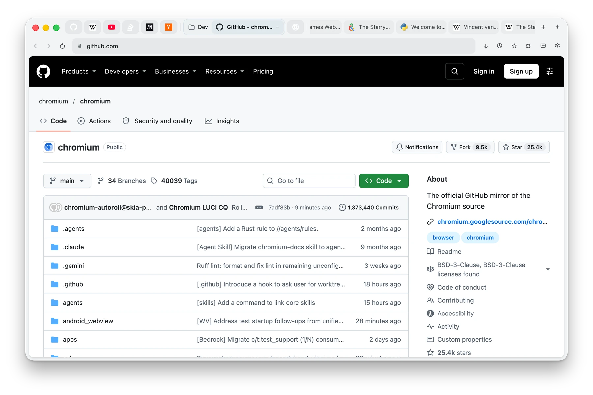
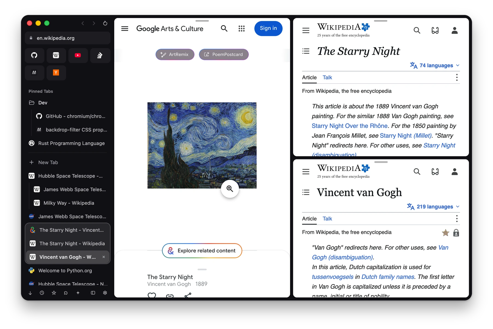
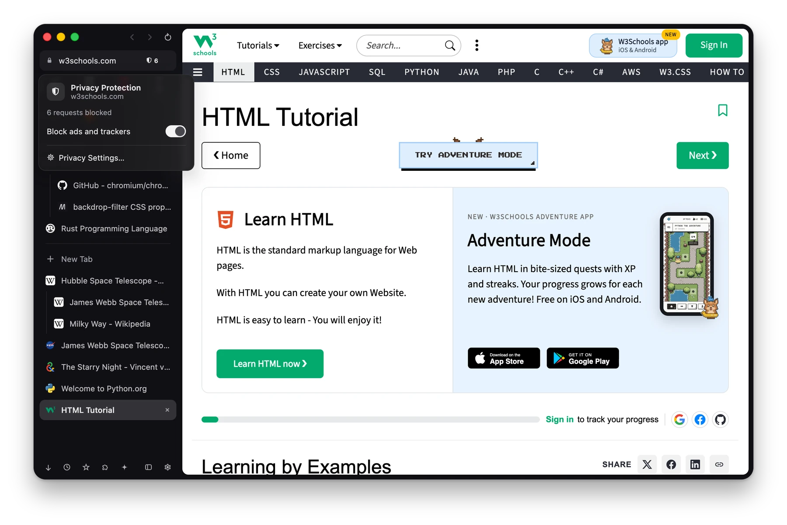

<div align="center">


# Starry Browser

A modern desktop browser built for clean workflows, native speed, and AI agents

[简体中文](README.md) · [English](README.en.md)

[](chromium.version)


</div>

## Screenshots

<!-- Screenshots are 1800 × 1202; GitHub renders them with height: auto. -->
<table>
  <tr>
    <td width="50%" align="center" valign="top">
      <a href="docs/images/en/hero.webp"></a>
      <p><strong>Main window</strong><br>Vertical sidebar navigation, favorite tiles, and pinned folders</p>
    </td>
    <td width="50%" align="center" valign="top">
      <a href="docs/images/en/layout-top.webp"></a>
      <p><strong>Top tab layout</strong><br>Switch anytime to classic top tabs and light mode</p>
    </td>
  </tr>
  <tr>
    <td width="50%" align="center" valign="top">
      <a href="docs/images/en/tabs.webp"></a>
      <p><strong>Tree tabs &amp; hover preview</strong><br>Collapsible tab trees with live thumbnails and CPU/memory stats</p>
    </td>
    <td width="50%" align="center" valign="top">
      <a href="docs/images/en/split.webp"></a>
      <p><strong>Split view</strong><br>View up to three pages side by side in a single window</p>
    </td>
  </tr>
  <tr>
    <td width="50%" align="center" valign="top">
      <a href="docs/images/en/assistant.webp"></a>
      <p><strong>Built-in AI assistant</strong><br>Summarize pages, ask in context, or act with approval controls</p>
    </td>
    <td width="50%" align="center" valign="top">
      <a href="docs/images/en/media.webp"></a>
      <p><strong>Media &amp; picture-in-picture</strong><br>Floating media island, live waveforms, and automatic PiP</p>
    </td>
  </tr>
  <tr>
    <td width="50%" align="center" valign="top">
      <a href="docs/images/en/layout-glass.webp"></a>
      <p><strong>Floating Liquid Glass sidebar</strong><br>Auto-hides cleanly and slides out on hover</p>
    </td>
    <td width="50%" align="center" valign="top">
      <a href="docs/images/en/privacy.webp"></a>
      <p><strong>Privacy &amp; content blocking</strong><br>Built-in ad and tracker blocking with per-site controls</p>
    </td>
  </tr>
</table>

## Features

- 🗂️ **Tabs & split view**: Top favorite tiles, pinned folders, collapsible tab trees, and hover previews with live thumbnails and CPU/memory stats; supports idle tab sleeping, automatic archiving of stale or duplicate tabs, one-click AI tab grouping, and up to three-pane split view in a single window
- ✨ **AI assistant & MCP**: Built-in floating or docked assistant to summarize, reference, or act on pages under granular approval modes (Ask, Agent, Auto-review); supports cloud and local models (OpenAI, DeepSeek, OpenRouter, Ollama, LM Studio, and custom OpenAI-compatible APIs) as well as local Claude Code and Codex installations, plus native MCP support for external agents
- 🏠 **New Tab**: Choose from Minimal command bar, Card dashboard (with drag-reorderable widgets for clock, shortcuts, now playing, recently closed, archive, weekly blocked stats, and notes), or blurred Overlay home, with glow, starry sky, solid, or custom image backgrounds
- 🎨 **Interface & layouts**: Switch between a docked sidebar, an auto-hiding Liquid Glass floating sidebar, and classic top tabs, with sidebar, top, or compact merged address bar options; supports dynamic tinting from the active site, plus floating glass pill or slim top-rail window controls on Windows and Linux
- 🎬 **Media & picture-in-picture**: Switching away from a video tab automatically docks it into a corner PiP player that snaps back on return or detaches to the desktop; includes a floating media island, an expandable sidebar media dock, and audio-driven wave progress with live scrolling loudness waveforms
- 🛡️ **Ad & tracker blocking**: Built-in native content filter compatible with EasyList, AdGuard, uBlock, and regional filter lists, with cookie-notice and annoyance filtering, custom subscriptions and rules, plus automatic URL tracking parameter stripping
- 🔒 **Anti-fingerprinting & location simulation**: Site-partitioned Canvas, WebGL, WebGPU, and audio fingerprint protection; simulate geolocation globally or per site with a built-in interactive map (including offline city search and fallback map) that automatically syncs the page's time zone
- 🚀 **Everyday tools**: Links opened from other apps launch in a lightweight peek window you can dismiss or promote to a full tab anytime; includes a multithreaded segmented downloader (resume, queuing, and speed limits) and a task manager with live resource charts
- 🧩 **Extensions & migration**: Full Chrome Web Store extension support, a first-launch setup assistant, and one-click import of bookmarks, history, and passwords from Chrome, Edge, Arc, Brave, Safari, and Firefox; localized in 简体中文, 繁體中文, English, 日本語, and 한국어
- ⚡ **Native cross-platform**: Built on Chromium with a native C++ Views UI for macOS, Windows, and Linux

## Installation

Download the package for your platform from [Releases](https://github.com/MeteorProject/StarryBrowser/releases):

- **macOS**: Open the `.dmg` and drag Starry Browser into **Applications** (builds are not notarized yet—if macOS blocks the first launch, right-click the app in Finder and choose **Open**, or go to **System Settings › Privacy & Security** and click **Open Anyway**)
- **Windows** (Windows 10+): Available as an installer (`setup.exe`) and a portable archive (`portable.zip`); builds are currently unsigned, so Windows SmartScreen may prompt on first run
- **Linux**: Available as `.deb` and `.rpm` packages

## Development

Quick start on macOS (requires Xcode and the Metal toolchain, at least 16 GB RAM, and 100 GB+ free disk space):

```bash
scripts/bootstrap.sh       # Fetch depot_tools into vendor/depot_tools
scripts/sync.sh            # Sync Chromium source, link starry/, and apply patches/
scripts/build.sh Release   # Build chrome (use Dev for faster incremental builds)
scripts/run.sh Release     # Launch with a temporary user data directory
```

For Windows and Linux build steps, build configuration, patch management, and localization checks, see [Development & Building](docs/development.md).

## Acknowledgments

- [Chromium](https://www.chromium.org/): Core browser engine and cross-platform framework
- [MapLibre GL JS](https://maplibre.org/), [OpenFreeMap](https://openfreemap.org/), [GeoNames](https://www.geonames.org/) (CC BY 4.0), and [Natural Earth](https://www.naturalearthdata.com/): Interactive map and offline city data for location simulation
- [EasyList](https://easylist.to/), [AdGuard Filters](https://github.com/AdguardTeam/AdguardFilters), [uBlock Origin uAssets](https://github.com/uBlockOrigin/uAssets), and community filter lists: Ad and tracker blocking rules
- [Big Buck Bunny](https://peach.blender.org): Sample film shown in screenshots (© Blender Foundation, CC BY 3.0)

## License

- Original Starry Browser code (`starry/`, `scripts/`, etc.) is licensed under [MPL-2.0](LICENSE).
- Upstream Chromium patches under `patches/` remain licensed under [BSD-3-Clause](patches/LICENSE).
