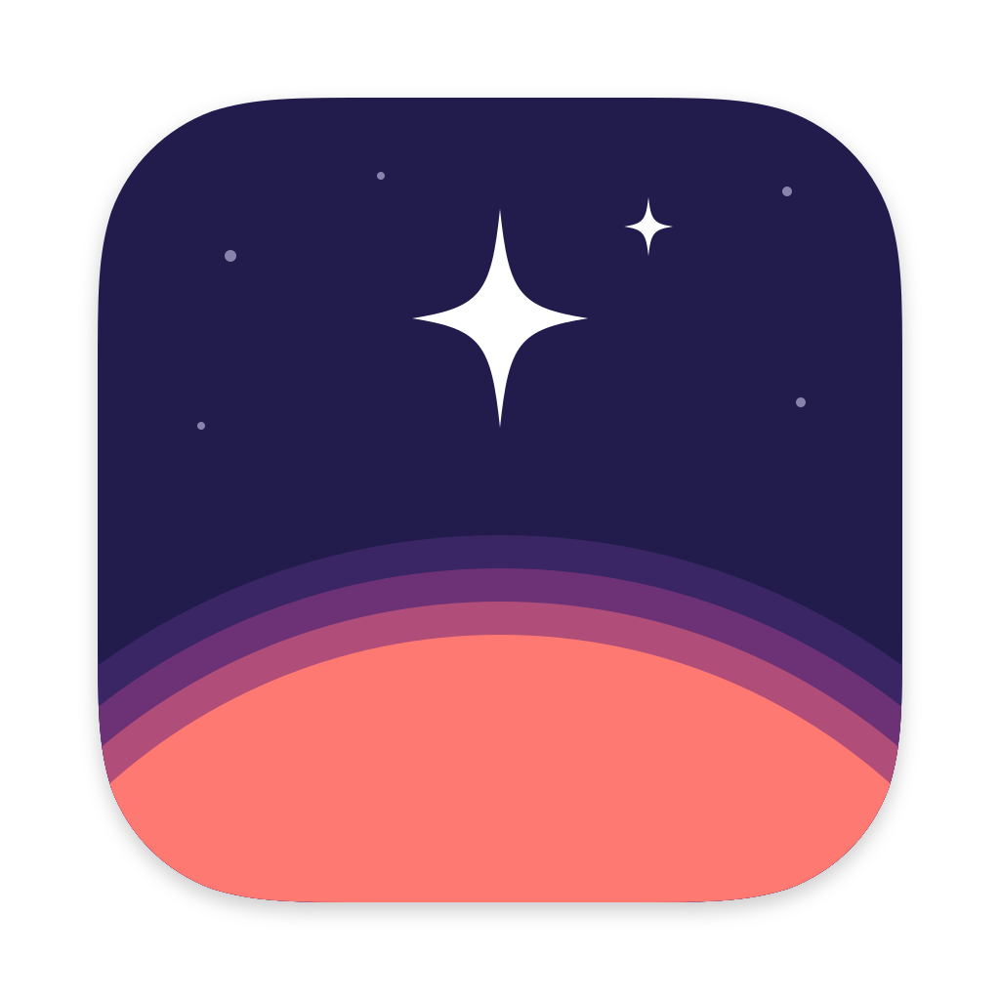
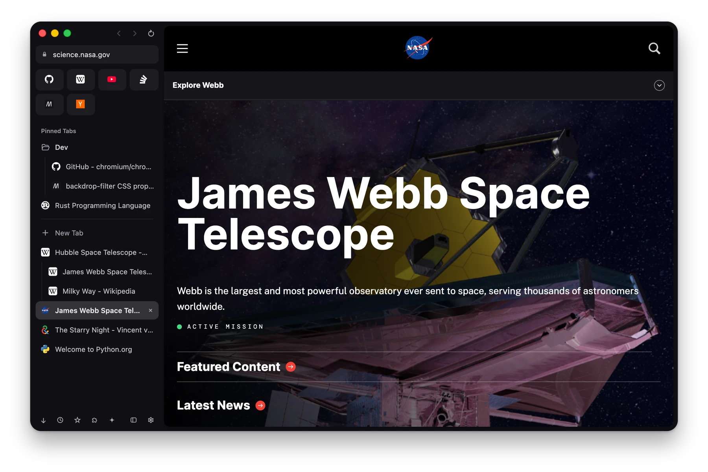
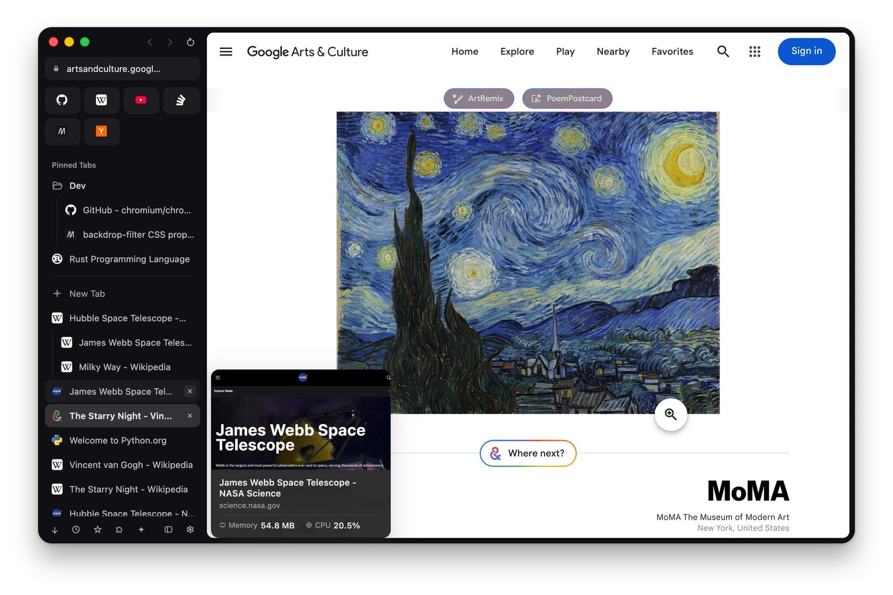
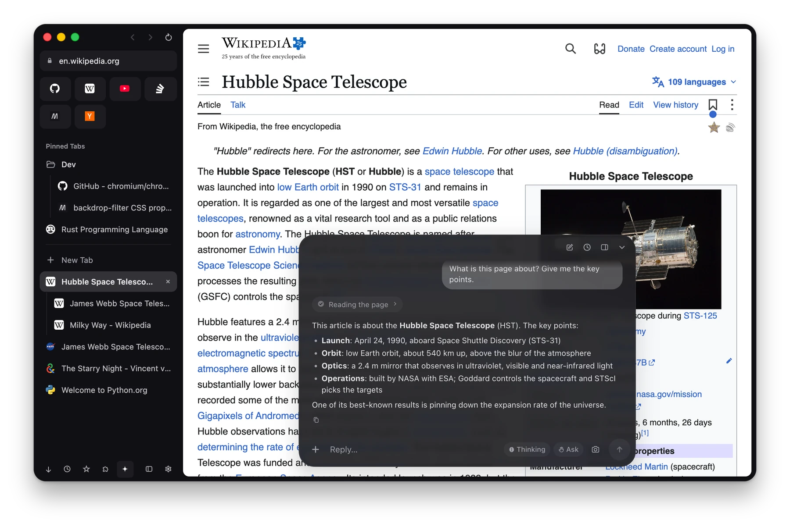
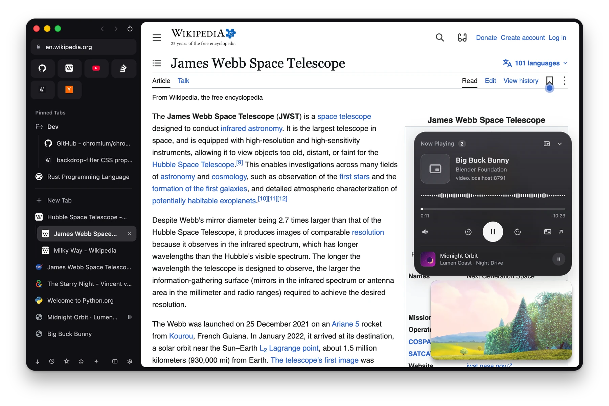
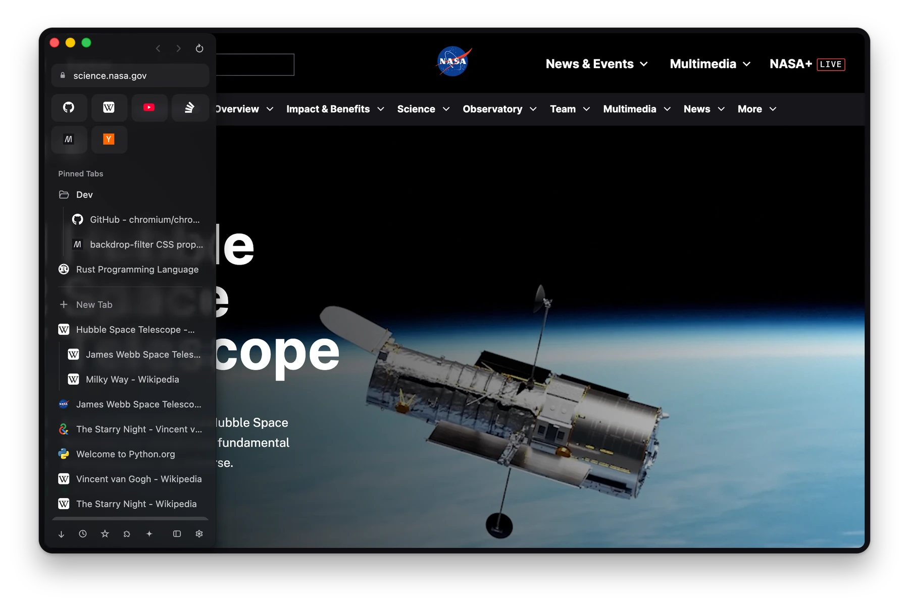

  
  <h1>Starry Browser</h1>
  
A modern desktop browser built for clean workflows, native speed, and AI agents.

  

    
    
    
    
  

  
<a href="README.md">简体中文</a> · English

## Tabs & Split View

  
  

Stay organized no matter how many tabs you open, and view up to three pages side by side in a single window.

- **Structured by default**: Keep favorite sites as top tiles, organize pinned tabs into folders, and follow links in collapsible tab trees—with live thumbnails and CPU/memory stats on hover.
- **Self-cleaning workspace**: Idle tabs automatically sleep to save memory, stale or duplicate tabs are archived out of the way, and AI can group cluttered tabs by topic in one click.

## AI Assistant

Summarize pages, ask questions in context, or let the assistant click, type, and navigate on your behalf with granular permission controls.

- **Bring your own model**: Works with OpenAI, DeepSeek, OpenRouter, and other cloud APIs, local models via Ollama or LM Studio, as well as Claude Code and Codex installed on your machine.
- **MCP ready**: External agents like Claude Code and Codex in your terminal can connect over MCP to drive the browser directly.

## Media

Switch away from a video tab and it automatically docks to the corner—snapping right back when you return, or detaching into a floating desktop window. Background audio gets a compact corner player so you can pause or skip tracks without hunting for the tab.

## Appearance

  
  

Switch freely between vertical sidebar tabs and classic top tabs, or auto-hide the sidebar into a floating Liquid Glass drawer. Beyond light and dark themes, the window frame can dynamically tint itself to match the current site.

## Privacy

Built-in ad and tracker blocking powered by EasyList, AdGuard, and uBlock filter lists, paired with fingerprinting protection and automatic stripping of URL tracking parameters—ready out of the box.

## Everyday Essentials

- **Peek windows**: Links opened from other apps launch in a lightweight preview window—close it when done, or promote it to a full browser tab anytime.
- **Fast downloads**: Built-in multithreaded downloader with resume support and speed limits.
- **Easy migration & extensions**: Full support for Chrome Web Store extensions, plus one-click import of bookmarks, history, and passwords from Chrome, Edge, Arc, Brave, Safari, and Firefox.
- **Multilingual UI**: Available in 简体中文, 繁體中文, English, 日本語, and 한국어.

## Building & Docs

Starry currently needs to be built from source. See [Development & Building](docs/development.md).

## License

- Original Starry Browser code (`starry/`, `scripts/`, etc.) is licensed under [MPL-2.0](LICENSE).
- Upstream Chromium patches under `patches/` remain licensed under [BSD-3-Clause](patches/LICENSE).

The film shown in screenshots is <a href="https://peach.blender.org">Big Buck Bunny</a>, © Blender Foundation, CC BY 3.0.
