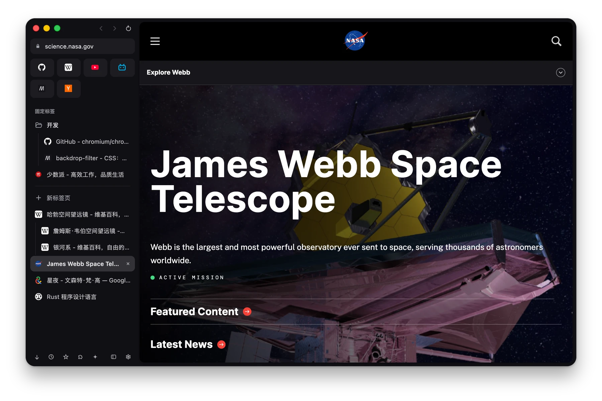
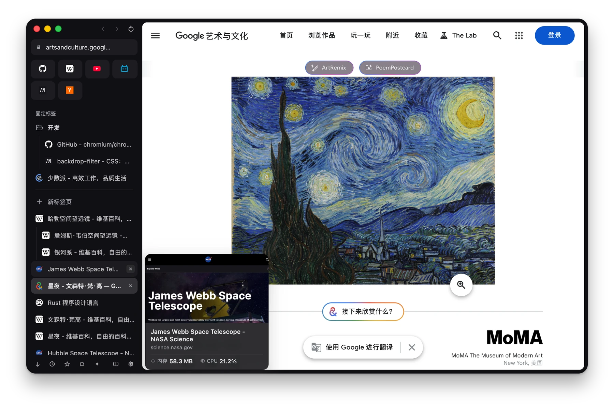
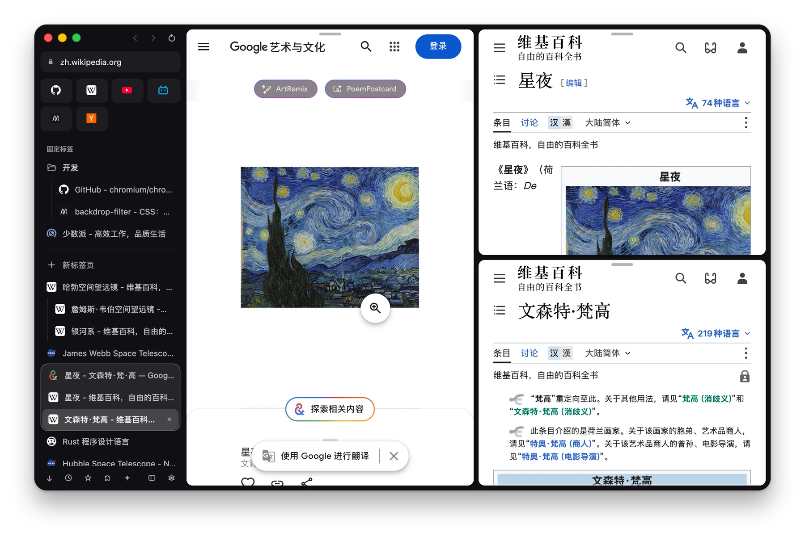
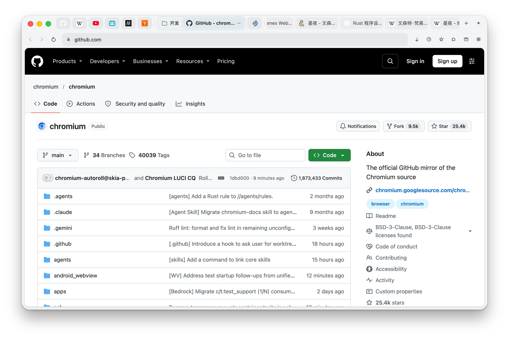
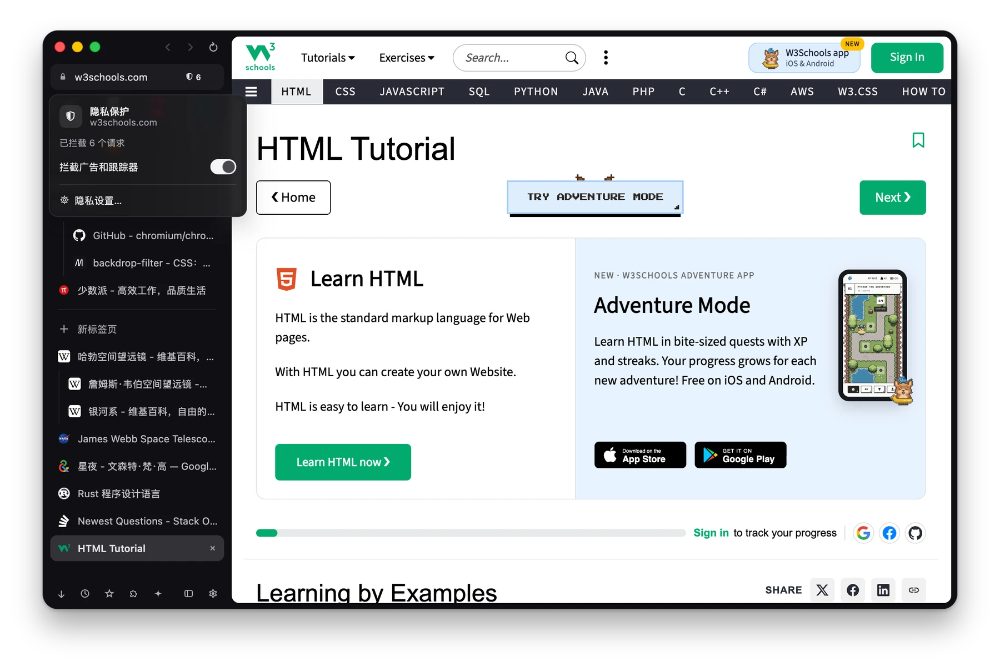

  
  <h1>Starry Browser</h1>
  
兼顾清爽体验与高效工作流的现代桌面浏览器。

  

    
    
    
    
  

  
简体中文 · <a href="README.en.md">English</a>

## 标签与分屏

  
  

网页开得再多也能井井有条，单窗口最多可同时拼排三个页面对照浏览。

- **清晰层级**：常用站点可设为顶部磁贴，常驻标签支持文件夹收纳；从页面点开的链接自动归入树状子标签，悬停即可预览画面与资源占用。
- **自动减负**：闲置标签自动休眠省内存，久未访问或重复的页面自动归档留存；标签杂乱时还可交给 AI 按主题一键归类。

## AI 助手

随时提炼当前网页要点、针对页面内容提问，或在你的授权下代为点击、输入和跳转页面。

- **模型自选**：支持 OpenAI、DeepSeek、OpenRouter 等主流云端服务与 Ollama、LM Studio 本地模型，也可直接调用本机已安装的 Claude Code 和 Codex。
- **连接外部智能体**：原生支持 MCP 协议，终端里的 Claude Code、Codex 等外部 Agent 可直接连入并操控浏览器。

## 音视频

切换标签页时，正在播放的视频会自动停靠到角落继续播放，切回即归位，也可拖出成为桌面独立小窗；后台播放音乐时同样配有悬浮迷你播控，不必切回原页面就能随时暂停或切歌。

## 界面与外观

  
  

支持垂直侧栏与传统顶部标签两种布局，侧栏也可自动收起，需要时以液态玻璃悬浮层滑出。除浅色与深色模式外，窗口配色还能自动跟随当前网页的主题色。

## 隐私保护

内置广告与跟踪器拦截（兼容 EasyList、AdGuard、uBlock 规则），配合浏览器指纹保护与链接跟踪参数自动清理，开箱即用。

## 日常体验

- **轻量预览小窗**：从其他应用点开的链接先在独立小窗中快速预览，看完即关，需要保留时一键转入主窗口。
- **多线程下载**：内置高速下载器，支持断点续传与限速。
- **无缝迁移与扩展**：完整兼容 Chrome 应用商店扩展，可从 Chrome、Edge、Arc、Brave、Safari、Firefox 等浏览器一键导入书签、历史记录和密码。
- **多语言界面**：提供简体中文、繁體中文、English、日本語、한국어。

## 构建与文档

目前需从源码构建运行，请参阅 [开发与构建](docs/development.md)。

## 许可证

- 本仓库原创代码（`starry/`、`scripts/` 等）采用 [MPL-2.0](LICENSE) 许可证。
- `patches/` 目录下针对 Chromium 上游的补丁保持与上游一致的 [BSD-3-Clause](patches/LICENSE) 许可证。

截图中的影片为 <a href="https://peach.blender.org">Big Buck Bunny</a>，© Blender Foundation，CC BY 3.0。
