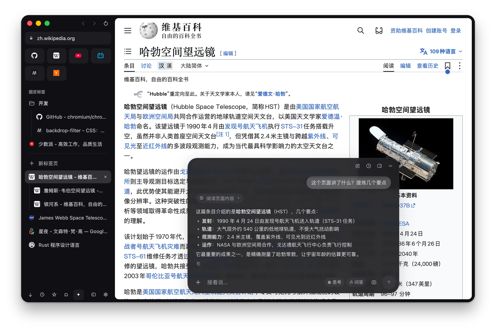
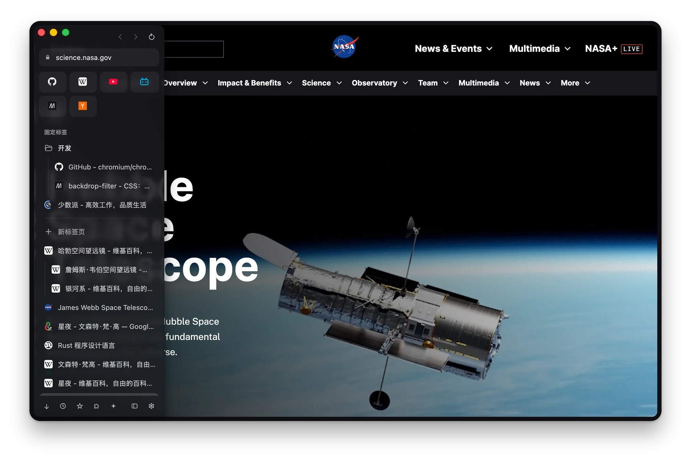

<div align="center">


# Starry Browser

兼顾清爽体验与高效工作流的原生桌面浏览器

[简体中文](README.md) · [English](README.en.md)

[](chromium.version)


</div>

## 截图

<!-- Screenshots are 1800 × 1202; GitHub renders them with height: auto. -->
<table>
  <tr>
    <td width="50%" align="center" valign="top">
      <a href="docs/images/hero.webp"></a>
      <p><strong>主界面</strong><br>垂直侧栏导航、顶部常用磁贴与固定文件夹</p>
    </td>
    <td width="50%" align="center" valign="top">
      <a href="docs/images/layout-top.webp"></a>
      <p><strong>顶部标签布局</strong><br>随时切换传统顶部标签与浅色外观</p>
    </td>
  </tr>
  <tr>
    <td width="50%" align="center" valign="top">
      <a href="docs/images/tabs.webp"></a>
      <p><strong>树状标签与悬停预览</strong><br>子链接自动归入树状层级，悬停查看画面与资源占用</p>
    </td>
    <td width="50%" align="center" valign="top">
      <a href="docs/images/split.webp"></a>
      <p><strong>多网页分屏</strong><br>单窗口最多同时拼排三个页面对照浏览</p>
    </td>
  </tr>
  <tr>
    <td width="50%" align="center" valign="top">
      <a href="docs/images/assistant.webp"></a>
      <p><strong>内置 AI 助手</strong><br>解读当前页面、回答上下文问题，或在授权下代为操作</p>
    </td>
    <td width="50%" align="center" valign="top">
      <a href="docs/images/media.webp"></a>
      <p><strong>音视频与画中画</strong><br>悬浮媒体岛、实时波形播控与切页自动画中画</p>
    </td>
  </tr>
  <tr>
    <td width="50%" align="center" valign="top">
      <a href="docs/images/layout-glass.webp"></a>
      <p><strong>液态玻璃浮动侧栏</strong><br>侧栏自动收起，鼠标移近边缘时悬浮滑出</p>
    </td>
    <td width="50%" align="center" valign="top">
      <a href="docs/images/privacy.webp"></a>
      <p><strong>隐私与内容拦截</strong><br>内置广告和跟踪器拦截，按站点快捷控制</p>
    </td>
  </tr>
</table>

## 特性

- 🗂️ **标签与分屏**：顶部常用磁贴、固定文件夹与可折叠树状子标签，悬停预览画面及内存/CPU 占用；支持闲置休眠、自动归档闲置/重复标签、AI 按主题一键整理，以及单窗口最多三页分屏
- ✨ **AI 助手与 MCP**：内置悬浮/侧栏 AI 助手，可解读和引用当前页面，并在分级授权（问答 / 代理 / 自动审核）下代为操作；支持 OpenAI、DeepSeek、OpenRouter、Ollama、LM Studio 等云端或本地模型，可直接复用本机已登录的 Claude Code 与 Codex，并原生开放 MCP 供外部智能体操控浏览器
- 🏠 **新标签页**：提供极简搜索、卡片小组件（时钟、快捷网站、正在播放、最近关闭、已归档、本周拦截统计与便签）和全屏浮层三种风格，支持柔光、星空、纯色及自定义图片背景
- 🎨 **界面与布局**：支持固定侧栏、液态玻璃自动隐藏浮动侧栏与传统顶部标签，地址栏可置于侧栏、顶部或紧凑并入网页顶部；窗口配色可跟随当前网页主题色，Windows 与 Linux 侧栏模式提供悬浮玻璃胶囊和纤细顶檐两种窗口控制样式
- 🎬 **音视频与画中画**：切走正在播放视频的标签页时自动进入角落画中画（切回即归位，也可拖出为桌面独立小窗）；配有悬浮媒体岛、可展开侧栏媒体卡片，以及音频驱动的动态波形进度与实时滚动音量波形
- 🛡️ **广告与跟踪拦截**：内置原生内容过滤引擎，兼容 EasyList、AdGuard、uBlock 规则及多地区/语言过滤列表，支持 Cookie 提示与干扰元素拦截、自定义订阅和规则，并自动清理链接跟踪参数
- 🔒 **指纹保护与位置模拟**：内置按站点隔离的 Canvas、WebGL、WebGPU 与音频指纹保护；支持通过内置地图（含离线城市库与底图）全局或按站点模拟地理位置，并自动联动网页时区
- 🚀 **日常效率**：其他应用点开的链接先在轻量预览小窗中打开，看完即关或一键转入主窗口；内置多线程分段下载器（支持断点续传、排队与限速）及带实时曲线的任务管理器
- 🧩 **扩展与迁移**：完整兼容 Chrome 应用商店扩展，内置首次启动设置向导，可从 Chrome、Edge、Arc、Brave、Safari、Firefox 等浏览器一键导入书签、历史记录与密码；提供简体中文、繁體中文、English、日本語、한국어 界面
- ⚡ **原生跨平台**：基于 Chromium 内核与 Views 原生 C++ 界面，支持 macOS、Windows 与 Linux

## 安装

前往 [Releases](https://github.com/MeteorProject/StarryBrowser/releases) 下载对应平台的安装包：

- **macOS**：下载 `.dmg` 并将应用拖入「应用程序」文件夹（安装包暂未公证，首次打开如遇系统拦截，请在访达中右键选择「打开」，或前往「系统设置 › 隐私与安全性」点击「仍要打开」）
- **Windows**（Windows 10+）：提供安装程序（`setup.exe`）与免安装便携版（`portable.zip`）；安装包暂未签名，首次运行如遇 SmartScreen 提示请选择仍要运行
- **Linux**：提供 `.deb` 与 `.rpm` 安装包

## 开发

以 macOS 为例（需要 Xcode 与 Metal 工具链，完整编译至少需要 16 GB 内存与 100 GB+ 可用磁盘空间）：

```bash
scripts/bootstrap.sh       # 获取 depot_tools 到 vendor/depot_tools
scripts/sync.sh            # 同步 Chromium 源码、链接 starry/ 并应用 patches/
scripts/build.sh Release   # 编译 chrome（日常增量开发可用 Dev）
scripts/run.sh Release     # 使用临时用户数据目录启动
```

Windows / Linux 构建步骤、构建参数、补丁管理与本地化检查见 [开发与构建指南](docs/development.md)。

## 致谢

- [Chromium](https://www.chromium.org/)：底层浏览器引擎与跨平台框架
- [MapLibre GL JS](https://maplibre.org/)、[OpenFreeMap](https://openfreemap.org/)、[GeoNames](https://www.geonames.org/)（CC BY 4.0）与 [Natural Earth](https://www.naturalearthdata.com/)：位置模拟地图与离线城市数据
- [EasyList](https://easylist.to/)、[AdGuard Filters](https://github.com/AdguardTeam/AdguardFilters) 与 [uBlock Origin uAssets](https://github.com/uBlockOrigin/uAssets) 等社区过滤列表：广告与跟踪拦截规则
- [Big Buck Bunny](https://peach.blender.org)：截图中的演示影片（© Blender Foundation，CC BY 3.0）

## 许可证

- 本仓库原创代码（`starry/`、`scripts/` 等）采用 [MPL-2.0](LICENSE) 许可证。
- `patches/` 目录下针对 Chromium 上游的补丁保持与上游一致的 [BSD-3-Clause](patches/LICENSE) 许可证。
